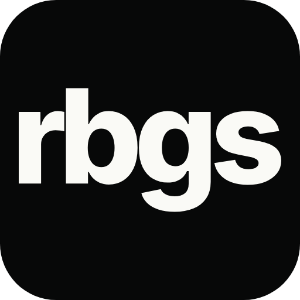

<h1> rbgs.io</h1>

The addon for [rbgs.io](https://rbgs.io) on WoW: Forever.

## Install with CurseForge

[Download rbgs.io on CurseForge](https://www.curseforge.com/wow/addons/rbgs-io) and select the **WoW: Forever** version.

## Install manually

1. Download the **Forever ZIP** from CurseForge.
2. Close WoW.
3. Extract the `rbgs.io` folder into:

   ```text
   World of Warcraft/_forever_/Interface/AddOns/
   ```

4. Start WoW and enable **rbgs.io** in the AddOns list.

If you previously installed a folder named `RBGS`, remove that old addon folder first.

Open the addon in game with `/rbgs`. Keep the rbgs.io companion running to upload recorded results.

Currently in testing. WSG support is still in development.
